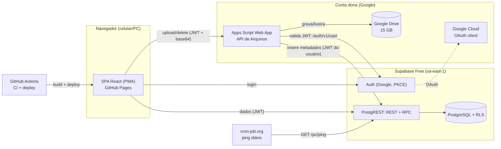
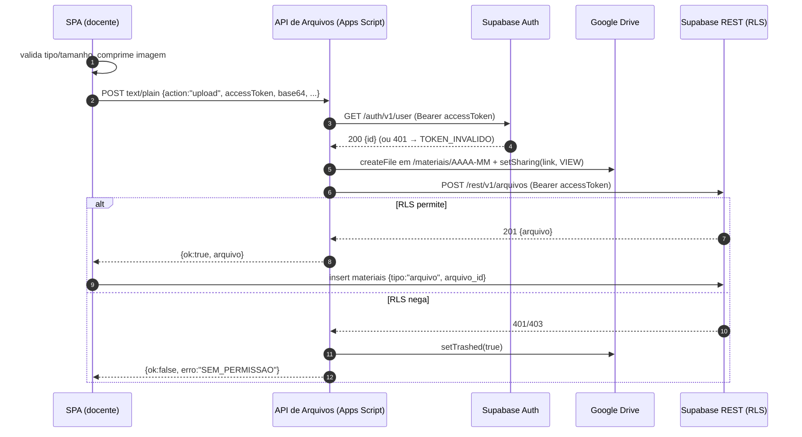
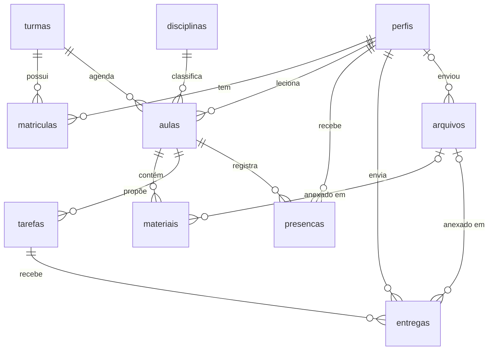

# SPEC — Sistema do Cursinho Popular Professor Agnes Lemos

> **Status:** v1.0 — aprovada para implementação · **Data:** 13/11/2026
> **Contexto acadêmico:** Projeto Integrador 2 (PI) — Univesp
> **Escopo desta SPEC:** fonte da verdade para implementar o sistema em fases. O que não estiver aqui está **fora do escopo**. Mudanças de escopo são feitas primeiro nesta SPEC (com registro no §19 Histórico) e só depois no código.

---

## Sumário

1. [Visão geral](#1-visão-geral)
2. [Decisões de arquitetura (ADRs)](#2-decisões-de-arquitetura-adrs)
3. [Requisitos do PI → solução](#3-requisitos-do-pi--solução)
4. [Requisitos funcionais](#4-requisitos-funcionais)
5. [Requisitos não funcionais](#5-requisitos-não-funcionais)
6. [Arquitetura e stack](#6-arquitetura-e-stack)
7. [Papéis e permissões](#7-papéis-e-permissões)
8. [Modelo de dados](#8-modelo-de-dados)
9. [Segurança no banco: RLS e RPCs](#9-segurança-no-banco-rls-e-rpcs)
10. [API de Arquivos (Apps Script + Google Drive)](#10-api-de-arquivos-apps-script--google-drive)
11. [Telas e rotas](#11-telas-e-rotas)
12. [Ambientes, contas e configuração](#12-ambientes-contas-e-configuração)
13. [Plano de implementação em fases (≈ 8h)](#13-plano-de-implementação-em-fases--8h)
14. [Estratégia de testes](#14-estratégia-de-testes)
15. [Regras para a implementação (anti-alucinação)](#15-regras-para-a-implementação-anti-alucinação)
16. [Operação e runbooks](#16-operação-e-runbooks)
17. [Riscos e mitigações](#17-riscos-e-mitigações)
18. [Glossário](#18-glossário)
19. [Histórico de decisões](#19-histórico-de-decisões)
20. [Apêndice A — Limites dos planos gratuitos](#apêndice-a--limites-dos-planos-gratuitos)
21. [Apêndice B — Fontes](#apêndice-b--fontes)

---

## 1. Visão geral

### 1.1 Sobre o cursinho

O **Cursinho Popular Professor Agnes Lemos** é um coletivo de educação popular **trans-referenciado** que acolhe pessoas trans, travestis, LGBTQIAPN+, negras, indígenas e periféricas. O foco é preparar para o **Enem** e para o **vestibular da Unicamp**.

- **Aulas:** presenciais, de segunda a sexta, das 19h às 22h.
- **Local:** Casa do Hip Hop, Rua Francisco Teodoro, 1030, Vila Industrial, Campinas-SP.
- **Natureza:** coletivo, sem CNPJ. Por isso não tem acesso a programas como Google for Nonprofits ou Workspace for Education.
- **Canais atuais:** site em Google Sites, Instagram e o e-mail `cursinhoagneslemos@gmail.com`.
- **Inscrições:** as de 2027 abrem em breve.

### 1.2 Problema

A gestão depende de **ferramentas e contas pessoais de voluntários** (e-mails, armazenamento). As informações ficam espalhadas, e a continuidade fica em risco quando alguém sai. Falta uma estrutura tecnológica **centralizada** para organizar a turma.

### 1.3 Objetivo

Um sistema web que funcione no celular e centralize quatro coisas:

1. **Presença** dos estudantes, por aula.
2. **Materiais por aula**, que também servem ao planejamento de aula pelos docentes.
3. **Entregas de trabalhos**, com avaliação pelos docentes.
4. **Gestão de pessoas, turmas e cronograma** pela coordenação.

Capacidade alvo: **~100 pessoas**. A arquitetura não foi pensada para escalar além disso, e isso é intencional.

### 1.4 Princípios (guiam qualquer decisão não prevista)

| # | Princípio | Consequência prática |
|---|---|---|
| P1 | **Custo zero** | Só serviços com plano gratuito que **não peçam cartão**. Pagar mensalidade não é opção. Se um limite estourar, a saída é uma nova conta gratuita. |
| P2 | **Centralização** | Os dados ficam em serviços do cursinho, não em contas pessoais (após a transferência, ver §16.2). |
| P3 | **Acolhimento** | Mostrar sempre o **nome social** e os pronomes. **Nunca** exibir o nome nem a foto da conta Google. Usar linguagem inclusiva. |
| P4 | **Dados mínimos (LGPD)** | Coletar apenas nome social, pronomes e e-mail. Nada além. |
| P5 | **Mobile-first e leve** | Pensar em celulares simples e em dados móveis limitados. |
| P6 | **Simplicidade** | O sistema deve caber em ~8h de implementação. Na dúvida, fica a opção mais simples que atende o requisito. |

---

## 2. Decisões de arquitetura (ADRs)

Formato de cada ADR: **contexto → decisão → alternativas descartadas**.

### ADR-01 — Software próprio, com o Google Classroom só como referência

- **Contexto.** O PI exige desenvolver software próprio. O pedido original citava o Moodle como referência.
- **Decisão.** Construir um sistema próprio, inspirado no Classroom: aulas ≈ tópicos, tarefas, entregas e devolutivas.
- **Alternativas descartadas:**

| Alternativa | Por que foi descartada |
|---|---|
| **Google Classroom puro** | Com conta pessoal, aceita até 250 membros por turma, o que atenderia. Mas não tem **chamada nativa** (o add-on "Attendance Taker" foi retirado do Marketplace em 01/03/2026) nem painel de gestão. Além disso, mostra o **nome da conta Google**, o que tira o controle do nome social. Cada arquivo enviado pelo docente ocupa o **Drive pessoal dele**, o que mantém a gestão descentralizada. E não satisfaz o PI. |
| **"Wrapper" do Classroom via API** | Os escopos do Classroom são **sensíveis**: em produção exigem verificação do app pelo Google, e em modo Teste o app fica limitado a 100 usuários com tokens que expiram. Seriam dois sistemas e dois cadastros. |
| **Moodle** | Precisa de servidor PHP e banco ligados 24/7. Não há hospedagem gratuita confiável, e o plano gratuito do MoodleCloud foi descontinuado (confirmar se necessário). Também é pesado demais para ~100 pessoas. |

### ADR-02 — Backend: Supabase (plano Free), sem servidor próprio

- **Decisão.** Usar o Supabase para três coisas:
  - **Auth:** login com Google.
  - **Banco:** PostgreSQL, com as regras de acesso em **Row Level Security (RLS)**.
  - **API:** a REST gerada automaticamente (PostgREST) e as **RPCs** (funções SQL).
- **Regras de negócio** ficam no banco, em RLS + RPC. Não há backend próprio para hospedar.
- **Região:** `sa-east-1` (São Paulo). Reduz a latência e mantém os dados no Brasil, o que ajuda com a LGPD.
- **Alternativas descartadas:**

| Alternativa | Por que foi descartada |
|---|---|
| **Firebase (Spark)** | Não pausa e envia e-mails de graça. Mas o **Cloud Storage exige o plano Blaze**, que pede cartão, e as Cloud Functions também. O banco seria NoSQL, pior para relatórios de frequência e mais fraco para o requisito de "banco de dados" do PI. |
| **Tudo em Google Apps Script + Sheets** | Exigiria login com senha feito à mão, o que é arriscado. Seria lento (1–3 s por ação) e difícil de testar, e "planilha como banco" pesa contra o PI. |
| **Backend próprio (Node/Django) + hospedagem grátis** | Os planos gratuitos atuais hibernam, não têm disco persistente ou pedem cartão. Seria mais código, mais tempo e mais pontos de falha. |

- **Cuidados conhecidos:**
  - O projeto Free **pausa após 7 dias sem atividade**. Mitigação: um *ping* diário (§16.4).
  - **Estourar a cota** pode restringir o projeto inteiro, com respostas HTTP 402. Por isso os arquivos **não** ficam no Supabase (ADR-03).

### ADR-03 — Arquivos no Google Drive, via Apps Script ("API de Arquivos")

- **Contexto.** Estimativa de volume: cerca de 360 aulas/ano × ~1,5 arquivo × ~3 MB, mais fotos e PDFs de trabalhos, dá **~4 GB/ano**. O Supabase Storage Free tem só **1 GB**, e estourar a cota afeta o projeto inteiro.
- **Decisão.** Um **Web App do Google Apps Script**, executando como a conta dona, recebe o arquivo, grava no **Google Drive** (15 GB gratuitos) e registra os metadados no Supabase **usando o token do próprio usuário**. Assim a RLS decide se a ação é permitida. Detalhes no §10.
- **Vídeos não são enviados.** Entram como **link do YouTube** (não listado).
- **Se o Drive encher:** cria-se uma nova conta Gmail dedicada, publica-se uma cópia do script e troca-se a URL na tabela `configuracoes`. Não é preciso republicar o app. Os arquivos antigos continuam acessíveis pelo link. Se o Drive encher, o **banco e o app continuam funcionando**.
- **Trade-off aceito.** Os arquivos ficam com compartilhamento **"qualquer pessoa com o link"**. O link só é exposto a quem a RLS permite ver o registro, e os IDs do Drive não são adivinháveis.
- **Alternativas descartadas:**

| Alternativa | Por que foi descartada |
|---|---|
| **Supabase Storage** | Capacidade insuficiente (1 GB). |
| **Firebase Storage** | Exige cartão. |
| **Cloudflare R2** | Exige cartão. |
| **Conta de serviço do Google** | Contas de serviço **não têm cota própria** no Drive. |
| **OAuth com refresh token numa Edge Function** | Mais configuração e um segredo a guardar. Fica como plano B (§10.7). |

### ADR-04 — Login somente com Google

- **Decisão.** Supabase Auth com o provider Google e fluxo **PKCE**. Não há senhas nem SMTP.
- **Por quê.** Quase todo celular Android já tem conta Google, e criar uma é grátis. Assim não existe suporte de "esqueci a senha". Além disso, o SMTP padrão do Supabase só entrega e-mails para a equipe do projeto.
- **Publicação.** Com escopos básicos (`openid`, `email`, `profile`), o app OAuth pode ir para **produção sem verificação do Google**. A tela de consentimento mostra o domínio `*.supabase.co`, o que é aceitável.
- **Nome social.** O nome e a foto vindos do Google **não são copiados nem exibidos**. A pessoa informa o nome social no primeiro acesso.

### ADR-05 — Front-end: SPA estática no GitHub Pages

- **Decisão.** **React + TypeScript + Vite + React Router**, publicado no **GitHub Pages** por GitHub Actions. O repositório é público: o Pages é gratuito para repositórios públicos, e a chave *publishable* do Supabase é pública por natureza.
- **Rotas.** O app usa `BrowserRouter` com `basename`. O fallback de SPA é feito copiando `index.html` para `404.html` no build.
- **Alternativas descartadas:**

| Alternativa | Por que foi descartada |
|---|---|
| **Vercel Hobby** | Os termos restringem o plano a uso pessoal e não comercial. |
| **Netlify** | O plano gratuito agora é medido em créditos. |
| **Cloudflare Pages** | Seria mais uma conta para gerenciar. É uma boa alternativa caso o GitHub Pages traga problemas. |

### ADR-06 — Presença por aula, registrada só pelo(a) docente da aula

- **Decisão do usuário.** A chamada é por **aula** (data + disciplina) e quem marca é **só** o(a) docente responsável. A coordenação **consulta** e gera relatórios, mas não marca.
- **Exceções.** Se a pessoa docente faltar, a coordenação **reatribui a aula** a quem vai substituir, e essa pessoa faz a chamada. Uma pessoa da coordenação que também dá aula faz a chamada das próprias aulas.

### ADR-07 — Avaliação flexível por tarefa

- **Decisão do usuário** ("deixar em aberto"). Cada tarefa define um `tipo_avaliacao`:

| Tipo | Como funciona |
|---|---|
| `nota` | 0 a 10, com uma casa decimal. |
| `conceito` | Valor escolhido de uma lista definida na tarefa. Padrão: `["Satisfatório", "Precisa revisar"]`. |
| `devolutiva` | Só comentário em texto. |

- A **devolutiva em texto** está disponível em todos os tipos.

### ADR-08 — Contas: começar na conta pessoal do dev e transferir depois

- **Decisão do usuário.** Supabase, Google Cloud (OAuth), GitHub e Apps Script/Drive começam na **conta pessoal do desenvolvedor**.
- **⚠️ Consequência.** Até a transferência, os **arquivos enviados ocupam o Drive pessoal do dev**. Se esse Drive encher, o Gmail pessoal dele para de receber e-mails.
- **Obrigatório antes do uso real (go-live):** executar o runbook §16.2. A recomendação é transferir para uma **conta Gmail dedicada ao sistema**, e não para o e-mail principal do cursinho, pelo mesmo motivo.

---

## 3. Requisitos do PI → solução

| Requisito do PI 2 | Como o sistema atende | Onde está na SPEC |
|---|---|---|
| **Framework web** | React + React Router (roteamento e *data APIs*) + Vite (build) | §6 |
| **Banco de dados** | PostgreSQL (Supabase): modelo relacional, DER, *migrations* versionadas, constraints, RLS | §8, §9 |
| **Nuvem** | Supabase Cloud (Auth + Postgres), GitHub Pages (hospedagem), Google Apps Script + Google Drive (arquivos), GitHub Actions (CI/CD) | §6, §12 |
| **API** | API REST gerada pelo PostgREST; **RPCs** próprias (`registrar_chamada`, `avaliar_entrega`…); **API de Arquivos** própria (Apps Script), que consome a Google Drive API (DriveApp) e a API REST do Supabase | §9.4, §10 |
| **Acessibilidade** | Meta WCAG 2.1 AA; testes automáticos com axe em todas as páginas; checklist manual (teclado, TalkBack) | §5.3, §14 |
| **Controle de versão** | Git + GitHub (código, *migrations* SQL e o código do Apps Script via `clasp`); Conventional Commits | §13, §15 |
| **Testes** | pgTAP (RLS e RPCs no banco), Vitest (unidade e componentes), Playwright (E2E + acessibilidade) | §14 |

> **Nota para o relatório do PI.** O React costuma ser classificado como biblioteca. Junto com o React Router e o Vite, ele forma o *framework* da aplicação. Se a banca exigir explicitamente um "framework full-stack", a alternativa sem mudar a arquitetura é usar o React Router v7 em **modo framework com `ssr: false`** (SPA). Avaliar só se for cobrado.

---

## 4. Requisitos funcionais

**Prioridades:**
- **P0** = obrigatório no MVP de 8h.
- **P1** = desejável, entra se houver tempo.
- **P2** = backlog.

### 4.1 Rastreabilidade com o pedido original

| Pedido original | Requisitos |
|---|---|
| Gerenciador de presença dos alunos | RF-20 a RF-23 |
| Compartilhar e dividir materiais por aula, para planejamento (textos, imagens, vídeos) | RF-10 a RF-14 |
| Alunos podem se cadastrar | RF-01 a RF-04 |
| Alunos acessam os materiais | RF-13 |
| Alunos compartilham trabalhos com docentes, que revisam e dão nota | RF-15 a RF-19 |
| Painel de gestão de docentes e estudantes | RF-05 a RF-09, RF-24, RF-25 |
| Capacidade de até 100 pessoas | RNF §5.2 |

### 4.2 Acesso e cadastro

| ID | Requisito | Prior. | Critério de aceite |
|---|---|---|---|
| RF-01 | Entrar com conta Google | P0 | O botão "Entrar com Google" leva ao consentimento do Google e volta logado. Não existe outra forma de login em produção. |
| RF-02 | Primeiro acesso (onboarding) | P0 | No 1º login, a pessoa informa o **nome social** (obrigatório, 2–80 caracteres) e os **pronomes** (opcional). Ela aceita o **aviso de privacidade** (obrigatório, registra `consentimento_em`). Nenhum campo vem preenchido com dados do Google. |
| RF-03 | Aguardar aprovação | P0 | Uma pessoa com status `pendente` ou `inativo` vê apenas a tela "Aguardando aprovação" (ou "Acesso desativado"), o próprio perfil e o botão de sair. A RLS impede leitura de qualquer outro dado. |
| RF-04 | Editar o próprio perfil | P0 | A pessoa altera o nome social e os pronomes. Não consegue alterar o papel, o status nem o e-mail (garantido no banco). |
| RF-05 | Aprovar cadastros em lote | P0 | A coordenação seleciona várias pessoas pendentes, escolhe o papel (estudante, docente ou coordenação) e, para estudantes, a turma, e clica em "Aprovar". Tudo acontece numa única operação (RPC). |
| RF-06 | Gerenciar pessoas | P0 | A coordenação lista as pessoas por status, altera o papel e ativa ou inativa. O sistema impede que a última pessoa ativa da coordenação perca o papel. |
| RF-07 | Gerenciar turmas e matrículas | P0 | A coordenação cria e edita turmas (nome, ano, ativa) e matricula ou desmatricula estudantes. |
| RF-08 | Gerenciar disciplinas | P0 | A coordenação cria, edita e desativa disciplinas (ex.: Matemática, Redação). |
| RF-09 | Cronograma de aulas | P0 | A coordenação cria e edita aulas (turma, disciplina, docente, data, horário, título) e pode **reatribuir o(a) docente**. |

### 4.3 Aulas e materiais

| ID | Requisito | Prior. | Critério de aceite |
|---|---|---|---|
| RF-10 | Docente cria as próprias aulas | P0 | A pessoa docente cria uma aula em uma turma ativa com ela mesma como responsável. Edita e exclui só as próprias aulas. |
| RF-11 | Materiais da aula | P0 | Tipos: **arquivo** (upload de até 15 MB), **link**, **vídeo** (URL do YouTube, exibido embutido via `youtube-nocookie.com`) e **texto** (texto simples com links clicáveis). Os materiais têm ordem. |
| RF-12 | Rascunho e publicado (planejamento) | P0 | O material nasce como **rascunho**, visível só para a pessoa docente e para a coordenação. "Publicar" o torna visível aos estudantes da turma. O planejamento da aula = materiais em rascunho. |
| RF-13 | Estudante acessa materiais | P0 | A pessoa estudante vê as aulas das suas turmas (agenda) e **apenas os materiais publicados**. Arquivos abrem no visualizador do Google Drive. |
| RF-14 | Compressão de imagens | P1 | Imagens com mais de 1600 px ou mais de 500 KB são redimensionadas e recomprimidas no navegador antes do envio (JPEG, qualidade ~0,8). |

### 4.4 Tarefas, entregas e avaliação

| ID | Requisito | Prior. | Critério de aceite |
|---|---|---|---|
| RF-15 | Docente cria tarefa na aula | P0 | Campos: título, instruções, prazo (opcional), `tipo_avaliacao`, opções de conceito (quando o tipo for `conceito`) e publicada (sim/não). |
| RF-16 | Estudante envia a entrega | P0 | Só em tarefas publicadas das próprias turmas. O conteúdo é um arquivo **e/ou** um link **e/ou** um comentário (pelo menos um deles). |
| RF-17 | Reenvio | P0 | É possível reenviar enquanto a entrega **não foi avaliada**. O reenvio substitui a entrega anterior, e o arquivo antigo vai para a lixeira. Entrega após o prazo é aceita e marcada como **"atrasada"**. |
| RF-18 | Docente avalia | P0 | A pessoa docente da aula vê a lista de estudantes da turma com a situação de cada um (pendente, enviada, atrasada, avaliada). Ela abre a entrega e avalia conforme o tipo (nota 0–10, conceito da lista ou só devolutiva), sempre podendo deixar devolutiva em texto. Pode reavaliar. |
| RF-19 | Estudante vê a avaliação | P0 | A pessoa estudante vê a nota ou o conceito e a devolutiva de cada entrega sua. |

### 4.5 Presença

| ID | Requisito | Prior. | Critério de aceite |
|---|---|---|---|
| RF-20 | Fazer a chamada | P0 | A pessoa docente **da aula** abre a aba Chamada. A lista mostra os estudantes matriculados (nome social e pronomes), todos marcados como "presente" de início. Ela alterna cada um para ausente ou justificada e salva. A chamada fica registrada em lote (RPC). Não é possível fazer chamada de aula com data futura. |
| RF-21 | Corrigir a chamada | P0 | A mesma pessoa docente reabre e altera a chamada a qualquer momento. |
| RF-22 | Estudante vê a própria frequência | P0 | Mostra o percentual geral e a lista de aulas com a situação (presente, ausente, justificada). |
| RF-23 | Relatório de frequência | P0 | A coordenação filtra por turma e período e vê, por estudante: aulas com chamada, presenças, ausências, justificadas e %. A pessoa docente vê o mesmo relatório restrito às próprias aulas. |
| RF-24 | Exportar relatório em CSV | P1 | CSV com separador `;` e BOM UTF-8, para abrir certo no Excel e no Google Sheets em pt-BR. |

**Regra de frequência:**
- **% = presentes ÷ aulas com chamada registrada para a pessoa** × 100, com uma casa decimal.
- As justificadas aparecem em coluna própria e **contam como não presença** no %. A regra é ajustável numa única função SQL (`frequencia`).
- Quem foi matriculado no meio do ano não é penalizado pelas aulas anteriores, porque essas aulas não têm registro de chamada para essa pessoa.

### 4.6 Administração

| ID | Requisito | Prior. | Critério de aceite |
|---|---|---|---|
| RF-25 | Armazenamento | P1 | A coordenação vê o uso do Drive (usado/limite, com alerta a partir de 80%), o total por finalidade e os **arquivos órfãos** (não referenciados, com mais de 24h), com opção de excluir. |
| RF-26 | Configurações | P0 | A coordenação edita a URL ativa da API de Arquivos e o rótulo da conta de armazenamento, sem precisar republicar o app. |
| RF-27 | Aviso de privacidade | P0 | A página pública `/privacidade` informa quais dados são coletados, para quê, quem vê, onde ficam guardados, por quanto tempo e como pedir a exclusão (§5.5). |
| RF-28 | App instalável (PWA) | P1 | Tem manifest e ícone para "Adicionar à tela inicial" no Android. Não há modo offline. |

### 4.7 Fora de escopo (decidido; não implementar)

- Entregas **avulsas**, sem tarefa. A entrega só existe como resposta a uma tarefa.
- A **coordenação marcar presença**.
- Qualquer dado de cadastro além de nome social, pronomes e e-mail: telefone, nome civil, nascimento, autodeclaração.
- Login com e-mail e senha em produção.
- Notificações (e-mail, push, WhatsApp), mural, fórum, chat, calendário, banco de questões.
- Upload de vídeo (usar link do YouTube).
- Modo offline, app nativo, multi-idioma, importação de planilhas.

**Backlog P2 (futuro):** mural de avisos; repetir aula semanalmente; importar pessoas via CSV; política automática de retenção; notificações.

---

## 5. Requisitos não funcionais

### 5.1 Custo

- **R$ 0/mês.** Nenhum serviço pode exigir cartão de crédito.
- Os limites dos planos gratuitos estão no Apêndice A. Se algum for atingido, a saída é uma **nova conta gratuita** (runbooks §16), nunca um plano pago.

### 5.2 Capacidade e desempenho

- ~100 pessoas cadastradas e ~30 simultâneas no pico (ex.: chamada + estudantes abrindo material).
- Bundle JS inicial de **≤ 250 KB gzip**, sem fontes web externas, com ícones *tree-shaken*.
- Telas principais com carregamento em **< 3 s** em 4G médio.
- Upload de até 15 MB por arquivo (§10). Imagens são comprimidas antes do envio (RF-14).

### 5.3 Acessibilidade (meta: WCAG 2.1 AA)

- HTML semântico: um `<h1>` por página, `<main>`, `<nav>`, link "Pular para o conteúdo" e `lang="pt-BR"`.
- Todo campo tem `<label>`. O erro é anunciado em texto (`aria-describedby`), nunca indicado só por cor.
- Foco visível. O foco vai para o `<h1>` a cada troca de rota. Tudo funciona por teclado.
- Contraste ≥ 4,5:1 (texto normal) e ≥ 3:1 (componentes). Alvos de toque ≥ 44×44 px.
- Toasts e avisos anunciados por `aria-live="polite"`. Respeitar `prefers-reduced-motion`.
- O layout funciona com zoom de 200% e em 320 px de largura. No celular, tabelas viram cartões.
- Ícones sempre acompanhados de texto ou de `aria-label`.
- Vídeos do YouTube embutidos com `title` descritivo.
- **Verificação:** axe (Playwright) sem violações *serious* ou *critical*, mais um roteiro manual com teclado e TalkBack (§14).

### 5.4 Linguagem e identidade

- Interface em **pt-BR com linguagem inclusiva**: "Boas-vindas", "estudante", "docente", "pessoa da coordenação". Evitar flexões de gênero desnecessárias.
- **Nunca** exibir o `full_name`, o `name` ou o `avatar_url` vindos do Google, e não guardar esses dados em `perfis`.
- **Opções de pronomes:**
  - ela/dela
  - ele/dele
  - elu/delu
  - outro (campo livre, até 30 caracteres)
  - prefiro não informar
- **Visibilidade:**
  - Estudantes **não veem** a lista de outros estudantes.
  - Docentes veem só o nome social e os pronomes dos estudantes das turmas onde dão aula.
  - O e-mail só aparece para a própria pessoa e para a coordenação.

### 5.5 Privacidade (LGPD)

- **Dados tratados:**
  - nome social, pronomes e e-mail
  - registros de presença
  - entregas, notas e devolutivas
  - arquivos enviados
- **Finalidade:** a gestão pedagógica do cursinho. **Base legal:** consentimento, registrado em `consentimento_em`, e execução da atividade educacional.
- **Acesso** restrito por papel (§7), garantido no banco (RLS).
- **Armazenamento:**
  - Banco: Supabase, região São Paulo.
  - Arquivos: Google Drive da conta dona.
- **Rastreadores:** nenhum (sem analytics, pixels ou fontes de terceiros).
- **Exclusão a pedido:** segue o runbook §16.6. A **retenção** é definida pela coordenação. Sugestão: excluir os dados até 12 meses após o fim do vínculo.
- **Contato do controlador:** o e-mail do cursinho, informado em `/privacidade`.

### 5.6 Segurança

- **RLS ativa em 100% das tabelas** do schema `public`, verificada por teste (§14).
- Funções `security definer`:
  - sempre com `set search_path = ''` e nomes totalmente qualificados;
  - validam `auth.uid()` e o papel **dentro** da função.
- As funções auxiliares de RLS ficam no schema `privado`, **não exposto** pela API.
- **Nenhuma secret key** (`sb_secret_…`/service role) fica no front-end, no Apps Script ou no repositório. Ela só é usada **localmente** nos testes E2E.
- `anon` não lê nenhuma tabela. A única exceção é `rpc/ping`.
- Escritas sensíveis (presença, entregas, avaliação, papel e status) **só via RPC**. Os privilégios de INSERT, UPDATE e DELETE nessas tabelas são revogados de `authenticated`.
- `.env*` nunca vai para o commit. Antes do primeiro push, conferir que o `.gitignore` cobre `.env*`, `dist/`, `supabase/.temp/`, `.clasprc.json`, `playwright-report/` e `test-results/`.

### 5.7 Disponibilidade e manutenção

- Um *ping* diário evita a pausa do Supabase (§16.4).
- Backup mensal manual (§16.5).
- Quem mantém o sistema pode ser voluntário sem perfil técnico. Por isso os runbooks em `docs/` são escritos passo a passo.

---

## 6. Arquitetura e stack

### 6.1 Visão geral



### 6.2 Fluxo de upload (exemplo: material)



### 6.3 Stack

As versões exatas são fixadas na F0 e registradas no §6.5.

| Camada | Tecnologia | Observação |
|---|---|---|
| Linguagem | TypeScript (strict) | Front-end e testes |
| UI | React + Vite | Template `react-ts` |
| Rotas | React Router (modo *data*: `createBrowserRouter`) | `basename = import.meta.env.BASE_URL` |
| Dados no cliente | `@supabase/supabase-js` v2 + `@tanstack/react-query` | Cache e estados de carregamento e erro |
| Estilo | Tailwind CSS v4 (plugin `@tailwindcss/vite`) | Sem biblioteca de componentes pesada; componentes próprios em `src/components/ui` |
| Ícones | `lucide-react` | Importação por ícone |
| PWA (P1) | `vite-plugin-pwa` | Só manifest + ícones, sem cache offline |
| Banco/Auth/API | Supabase (Postgres, PostgREST, GoTrue) | CLI `supabase` como devDependency (`npx supabase …`) |
| Arquivos | Google Apps Script (V8) + DriveApp | Versionado em `apps-script/` com `@google/clasp` |
| Testes | pgTAP (`supabase test db`), Vitest + Testing Library, Playwright + `@axe-core/playwright` | §14 |
| Qualidade | ESLint (template Vite) + `tsc -b` | — |
| CI/CD | GitHub Actions + GitHub Pages | §12.4 |
| Datas | `Intl.DateTimeFormat('pt-BR', { timeZone: 'America/Sao_Paulo' })` | Sem biblioteca de datas |

**Ambiente local disponível:** Node 26, npm 11, Git 2.55, Docker 29 (Rancher Desktop) e Python 3.13. Python se chama com `py`, nunca com `python`. Não há `gh` instalado: o repositório remoto é criado pela web.

### 6.4 Estrutura de pastas

```
/
├─ SPEC.md                  ← este documento (fonte da verdade)
├─ CLAUDE.md                ← instruções curtas para sessões de IA (criado na F0)
├─ README.md                ← visão geral + como rodar
├─ docs/                    ← runbooks (§16)
│  ├─ setup.md
│  ├─ transferencia-de-contas.md
│  └─ operacao.md
├─ supabase/
│  ├─ config.toml
│  ├─ migrations/           ← SQL versionado (nunca editar migration já aplicada)
│  ├─ seed.sql              ← turmas/disciplinas de exemplo (sem pessoas reais)
│  └─ tests/database/       ← pgTAP (*.test.sql)
├─ apps-script/
│  ├─ Code.js               ← API de Arquivos (§10)
│  ├─ appsscript.json       ← manifest (webapp: USER_DEPLOYING / ANYONE_ANONYMOUS)
│  └─ .clasp.json           ← scriptId (sem segredos)
├─ e2e/                     ← Playwright (*.spec.ts) + global-setup.ts
├─ public/                  ← ícones/manifest
├─ src/
│  ├─ main.tsx · router.tsx · index.css
│  ├─ lib/                  ← supabase.ts, arquivos.ts, youtube.ts, imagem.ts, csv.ts, datas.ts
│  ├─ auth/                 ← AuthProvider.tsx, RequireStatus.tsx, RequirePapel.tsx
│  ├─ components/ui/        ← Button, Field, Select, Tabs, Card, Toast, EmptyState, ConfirmDialog, FileInput
│  ├─ components/           ← compostos (MaterialItem, ChamadaLista, AvaliacaoForm…)
│  ├─ pages/publico/        ← Entrar, Privacidade
│  ├─ pages/acesso/         ← PrimeiroAcesso, Aguardando
│  ├─ pages/estudante/
│  ├─ pages/docente/
│  ├─ pages/coordenacao/
│  └─ types/database.ts     ← GERADO por `supabase gen types` (não editar)
└─ .github/workflows/       ← ci.yml, deploy.yml (+ db-e2e.yml P1)
```

### 6.5 Versões fixadas

Preencher na F0 com as versões efetivamente instaladas. Depois disso, atualizar só deliberadamente.

| Pacote | Versão |
|---|---|
| react / react-dom | _(F0)_ |
| vite | _(F0)_ |
| react-router | _(F0)_ |
| @supabase/supabase-js | _(F0)_ |
| @tanstack/react-query | _(F0)_ |
| tailwindcss / @tailwindcss/vite | _(F0)_ |
| supabase (CLI) | _(F0)_ |
| vitest / @testing-library/react | _(F0)_ |
| @playwright/test / @axe-core/playwright | _(F0)_ |
| @google/clasp | _(F0)_ |
| vite-plugin-pwa (P1) | _(F0)_ |

---

## 7. Papéis e permissões

### 7.1 Papéis e status

- **`papel_usuario`:**

| Papel | Quem é |
|---|---|
| `estudante` | Pessoa matriculada em turmas |
| `professor` | Docente |
| `coordenacao` | Gestão. Pode também dar aulas. |

- **`status_usuario`:**
  - `pendente`: recém-cadastrado.
  - `ativo`
  - `inativo`: recusado ou desligado.
  - Só `ativo` acessa dados.
- **Docência é por aula.** As ações de docente (materiais, tarefas, chamada, avaliação) valem para a pessoa que é `aulas.professor_id`, seja `professor` ou `coordenacao`. O papel `professor` permite **criar** aulas para si mesmo.
- **Primeira pessoa da coordenação:** é criada por SQL, pelo dono do projeto (§16.1).

### 7.2 Matriz de permissões (visão funcional)

| Ação | Estudante | Docente (da aula) | Coordenação |
|---|---|---|---|
| Ver o próprio perfil e editar nome social e pronomes | ✅ | ✅ | ✅ |
| Ver e-mail e status de outras pessoas | ❌ | ❌ | ✅ |
| Ver nome social e pronomes de estudantes | ❌ | ✅ das turmas onde leciona | ✅ |
| Ver nome social e pronomes da equipe (docentes e coordenação) | ✅ | ✅ | ✅ |
| Aprovar cadastros, mudar papel e status | ❌ | ❌ | ✅ |
| Turmas, matrículas e disciplinas (escrita) | ❌ | ❌ | ✅ |
| Criar aula | ❌ | ✅ (para si) | ✅ (para qualquer docente) |
| Editar ou excluir aula, reatribuir docente | ❌ | ✅ as próprias (sem reatribuir) | ✅ todas |
| Ver aulas (agenda) | ✅ das suas turmas | ✅ das turmas onde leciona | ✅ todas |
| Materiais: criar, editar, publicar | ❌ | ✅ | ❌ (só exclui, para moderação) |
| Materiais: ver | ✅ publicados das suas turmas | ✅ das próprias aulas (inclusive rascunhos) | ✅ todos |
| Tarefas: criar, editar, publicar | ❌ | ✅ | ❌ (só exclui) |
| Enviar e reenviar entrega | ✅ (até ser avaliada) | ❌ | ❌ |
| Avaliar entrega | ❌ | ✅ | ❌ |
| Ver entregas e avaliações | ✅ as próprias | ✅ das próprias tarefas | ✅ todas |
| **Fazer e corrigir chamada** | ❌ | ✅ **só da própria aula** | ❌ |
| Ver frequência | ✅ a própria | ✅ das próprias aulas | ✅ todas |
| Armazenamento e configurações | ❌ | ❌ | ✅ |

---

## 8. Modelo de dados

**Convenções:**
- Schema `public`, nomes em português sem acento, `snake_case`.
- PK `id uuid default gen_random_uuid()`, salvo quando indicado.
- Datas em `timestamptz default now()`.
- Todo FK tem índice.

### 8.1 DER



### 8.2 Tipos enumerados

| Enum | Valores |
|---|---|
| `papel_usuario` | `estudante`, `professor`, `coordenacao` |
| `status_usuario` | `pendente`, `ativo`, `inativo` |
| `status_presenca` | `presente`, `ausente`, `justificada` |
| `tipo_material` | `arquivo`, `link`, `video`, `texto` |
| `tipo_avaliacao` | `nota`, `conceito`, `devolutiva` |
| `finalidade_arquivo` | `material`, `entrega` |

### 8.3 Tabelas

**`perfis`** — 1:1 com `auth.users`. A linha é criada por trigger.

| Coluna | Tipo | Regras |
|---|---|---|
| id | uuid PK | FK `auth.users(id)` **on delete cascade** |
| email | text not null | Copiado de `auth.users.email` pelo trigger |
| nome_social | text null | Nulo até o onboarding; 2–80 caracteres (CHECK) |
| pronomes | text null | Até 30 caracteres |
| papel | papel_usuario not null | default `estudante` |
| status | status_usuario not null | default `pendente` |
| consentimento_em | timestamptz null | Preenchido no onboarding |
| criado_em / atualizado_em | timestamptz | `atualizado_em` mantido por trigger |

O trigger `on_auth_user_created` (AFTER INSERT em `auth.users`, `security definer`) insere `(id, email)` **e nada mais**. Não copia `raw_user_meta_data` (nome e foto do Google).

**`turmas`**

| Coluna | Tipo | Regras |
|---|---|---|
| id | uuid PK | |
| nome | text not null | Ex.: "Turma 2027" |
| ano | int not null | |
| ativa | bool not null | default true |
| criado_em | timestamptz | |

**`matriculas`**

| Coluna | Tipo | Regras |
|---|---|---|
| estudante_id | uuid | FK `perfis` on delete cascade |
| turma_id | uuid | FK `turmas` on delete cascade |
| criado_em | timestamptz | |

PK composta: `(estudante_id, turma_id)`.

**`disciplinas`**

| Coluna | Tipo | Regras |
|---|---|---|
| id | uuid PK | |
| nome | text unique not null | |
| ativa | bool | default true |

**`aulas`**

| Coluna | Tipo | Regras |
|---|---|---|
| id | uuid PK | |
| turma_id | uuid not null | FK `turmas` on delete cascade |
| disciplina_id | uuid not null | FK `disciplinas` on delete restrict |
| professor_id | uuid not null | FK `perfis` on delete restrict. Um trigger valida que a pessoa é `professor` ou `coordenacao` e está `ativo`. |
| data | date not null | |
| inicio | time null | |
| titulo | text not null | 2–120 caracteres |
| criado_por | uuid | default `auth.uid()` |
| criado_em / atualizado_em | timestamptz | |

Índices: `(turma_id, data)` e `(professor_id, data)`.

**`arquivos`** — metadados dos arquivos no Drive. A linha é inserida **pela API de Arquivos com o JWT do usuário**.

| Coluna | Tipo | Regras |
|---|---|---|
| id | uuid PK | |
| drive_file_id | text unique not null | |
| nome | text not null | Nome original |
| mime_type | text not null | |
| tamanho_bytes | bigint not null | CHECK > 0 |
| url_visualizacao | text not null | `https://drive.google.com/file/d/{id}/view` |
| finalidade | finalidade_arquivo not null | |
| conta_armazenamento | text not null | Rótulo da conta/endpoint (ex.: `drive-01`), usado na migração |
| enviado_por | uuid null | default `auth.uid()`; FK `perfis` on delete set null |
| criado_em | timestamptz | |

**`materiais`**

| Coluna | Tipo | Regras |
|---|---|---|
| id | uuid PK | |
| aula_id | uuid not null | FK `aulas` on delete cascade |
| tipo | tipo_material not null | |
| titulo | text not null | |
| conteudo | text null | Obrigatório se `tipo = 'texto'` |
| url | text null | Obrigatório se `tipo in ('link','video')`; `video` deve ser URL do YouTube (validação no cliente) |
| arquivo_id | uuid null | Obrigatório se `tipo = 'arquivo'`; FK `arquivos` on delete restrict |
| publicado | bool not null | default **false** (rascunho) |
| ordem | int not null | default 0 |
| criado_por | uuid | default `auth.uid()` |
| criado_em / atualizado_em | timestamptz | |

CHECK `materiais_tipo_campos`: garante os campos obrigatórios de cada tipo.

**`tarefas`**

| Coluna | Tipo | Regras |
|---|---|---|
| id | uuid PK | |
| aula_id | uuid not null | FK `aulas` on delete cascade |
| titulo | text not null | |
| instrucoes | text null | |
| prazo | timestamptz null | |
| tipo_avaliacao | tipo_avaliacao not null | default `nota` |
| opcoes_conceito | text[] null | Obrigatório e não vazio se o tipo for `conceito`. Default de UI: `{Satisfatório,Precisa revisar}` |
| publicada | bool not null | default false |
| criado_por / criado_em / atualizado_em | | |

**`entregas`**

| Coluna | Tipo | Regras |
|---|---|---|
| id | uuid PK | |
| tarefa_id | uuid not null | FK `tarefas` on delete cascade |
| estudante_id | uuid not null | FK `perfis` on delete cascade |
| arquivo_id | uuid null | FK `arquivos` on delete restrict |
| link | text null | |
| comentario | text null | Até 2000 caracteres |
| enviada_em | timestamptz not null | Atualizado a cada (re)envio |
| nota | numeric(3,1) null | CHECK 0–10 |
| conceito | text null | |
| devolutiva | text null | |
| avaliada_por | uuid null | FK `perfis` |
| avaliada_em | timestamptz null | Não nulo = avaliada (bloqueia reenvio) |

UNIQUE `(tarefa_id, estudante_id)`. CHECK: `arquivo_id`, `link` e `comentario` não podem ser todos nulos.

- **"Atrasada"** é derivada: `enviada_em > tarefas.prazo`.
- **Situação na UI:**
  - `pendente`: sem linha.
  - `enviada` ou `atrasada`: com linha e `avaliada_em` nulo.
  - `avaliada`: `avaliada_em` não nulo.

**`presencas`**

| Coluna | Tipo | Regras |
|---|---|---|
| aula_id | uuid | FK `aulas` on delete cascade |
| estudante_id | uuid | FK `perfis` on delete cascade |
| status | status_presenca not null | |
| registrado_por | uuid not null | |
| registrado_em | timestamptz | |

PK composta: `(aula_id, estudante_id)`. Índice: `(estudante_id)`.

**`configuracoes`**

| Coluna | Tipo | Regras |
|---|---|---|
| chave | text PK | |
| valor | jsonb not null | |
| atualizado_em | timestamptz | |

Chaves iniciais (via migration/seed):
- `api_arquivos`: `{"url": "<URL /exec>", "conta": "drive-01"}`
- `limites`: `{"max_mb": 15}`

### 8.4 Efeitos colaterais conhecidos (intencionais)

- **Excluir uma aula** apaga em cascata os materiais, as tarefas, as entregas e as presenças, mas **não** as linhas de `arquivos`. Esses arquivos viram **órfãos** e são limpos na tela Armazenamento (RF-25). Com P1, o cliente exclui os arquivos logo após a aula.
- **Excluir uma pessoa** (runbook LGPD) apaga em cascata o perfil, as matrículas, as entregas e as presenças. Os arquivos dela viram órfãos. Uma aula sob responsabilidade da pessoa **bloqueia** a exclusão até ser reatribuída.

---

## 9. Segurança no banco: RLS e RPCs

### 9.1 Princípios

1. `alter table … enable row level security` em **todas** as tabelas de `public`.
2. **Privilégios:**
   - `revoke all` de `anon` em todas as tabelas.
   - Para `authenticated`, revogar INSERT/UPDATE/DELETE em `perfis` (exceto o UPDATE de colunas, item 3), `entregas` e `presencas`. Nessas tabelas, a escrita é só por RPC.
3. **Colunas de `perfis`:** `grant update (nome_social, pronomes, consentimento_em) on public.perfis to authenticated`, junto com uma policy de UPDATE com `id = (select auth.uid())`.
4. **Policies:**
   - Sempre `to authenticated`.
   - Funções chamadas como `(select privado.fn())`, para cache por statement.
   - Policies separadas por comando: SELECT, INSERT, UPDATE e DELETE.
5. **Funções `security definer`:**
   - `set search_path = ''`
   - Nomes qualificados (`public.aulas`).
   - Validação explícita de `auth.uid()` e do status `ativo`.
   - Erros com `raise exception` e mensagem em pt-BR.

### 9.2 Funções auxiliares (schema `privado`, não exposto na API)

Todas são `stable`, `security definer` e `set search_path = ''`. O schema tem `grant usage on schema privado to authenticated` e `grant execute` em cada função.

| Função | Retorna true quando… |
|---|---|
| `privado.esta_ativo()` | O perfil de `auth.uid()` tem status `ativo` |
| `privado.eh_coordenacao()` | Ativo e com papel `coordenacao` |
| `privado.eh_docente()` | Ativo e com papel em (`professor`, `coordenacao`) |
| `privado.estuda_na_turma(turma uuid)` | Ativo e com matrícula na turma |
| `privado.leciona_na_turma(turma uuid)` | Ativo e com alguma aula da turma com `professor_id = auth.uid()` |
| `privado.professor_da_aula(aula uuid)` | Ativo e com `aulas.professor_id = auth.uid()` |
| `privado.turma_da_aula(aula uuid)` | Retorna o `turma_id` (uuid), ou null |
| `privado.arquivo_do_usuario(arquivo uuid, fin finalidade_arquivo)` | O arquivo existe, tem `enviado_por = auth.uid()` e a `finalidade` indicada. Por ser `security definer`, evita que a policy de `materiais` dependa da RLS de `arquivos`, o que poderia gerar recursão de policies. |

### 9.3 Policies por tabela

Legenda:
- **C** = `eh_coordenacao()`
- **PA(x)** = `professor_da_aula(x)`
- **ET(x)** = `estuda_na_turma(x)`
- **LT(x)** = `leciona_na_turma(x)`
- **uid** = `(select auth.uid())`

| Tabela | SELECT | INSERT | UPDATE | DELETE |
|---|---|---|---|---|
| perfis | `id = uid` ou C | — (só trigger) | `id = uid` (colunas liberadas por grant) | — (runbook) |
| turmas | `esta_ativo()` | C | C | C |
| disciplinas | `esta_ativo()` | C | C | C |
| matriculas | `estudante_id = uid` ou C ou LT(turma_id) | C | — | C |
| aulas | C ou `professor_id = uid` ou ET(turma_id) ou LT(turma_id) | C ou (`eh_docente()` e `professor_id = uid`) | using: C ou `professor_id = uid` · check: C ou `professor_id = uid` | C ou `professor_id = uid` |
| materiais | C ou PA(aula_id) ou (`publicado` e ET(turma_da_aula(aula_id))) | PA(aula_id) e (`arquivo_id` nulo ou `arquivo_do_usuario(arquivo_id, 'material')`) | PA(aula_id) (mesmo check do insert) | PA(aula_id) ou C |
| tarefas | C ou PA(aula_id) ou (`publicada` e ET(turma_da_aula(aula_id))) | PA(aula_id) | PA(aula_id) | PA(aula_id) ou C |
| entregas | `estudante_id = uid` ou PA(aula da tarefa) ou C | RPC | RPC | — |
| presencas | `estudante_id = uid` ou PA(aula_id) ou C | RPC | RPC | — |
| arquivos | `enviado_por = uid` ou C ou existe material/entrega **visível** que o referencia (a subconsulta respeita a RLS das outras tabelas) | `esta_ativo()` e `enviado_por = uid` e (`finalidade = 'entrega'` ou `eh_docente()`) | — | `enviado_por = uid` ou C |
| configuracoes | `esta_ativo()` | C | C | C |

**Trigger `aulas_valida_professor`** (BEFORE INSERT/UPDATE): exige que `professor_id` aponte para um perfil `ativo` com papel `professor` ou `coordenacao`.

### 9.4 RPCs (schema `public`, expostas via `POST /rest/v1/rpc/<nome>`)

| RPC | Quem pode | Comportamento |
|---|---|---|
| `aprovar_cadastros(p_ids uuid[], p_papel papel_usuario default 'estudante', p_turma_id uuid default null) → int` | C | Para cada id `pendente`: status `ativo` + papel. Se o papel for `estudante` e houver turma, cria a matrícula (`on conflict do nothing`). Retorna a quantidade aprovada. |
| `definir_papel(p_id uuid, p_papel papel_usuario) → void` | C | Bloqueia se a mudança deixar **0 pessoas ativas na coordenação**. |
| `definir_status(p_id uuid, p_status status_usuario) → void` | C | Mesma proteção. |
| `estudantes_da_turma(p_turma_id uuid) → table(id, nome_social, pronomes)` | C ou LT | Somente estudantes `ativo` matriculados, ordenados por `nome_social`. |
| `equipe() → table(id, nome_social, pronomes, papel)` | `esta_ativo()` | Pessoas ativas com papel `professor` ou `coordenacao` (para mostrar quem dá cada aula). |
| `enviar_entrega(p_tarefa_id uuid, p_arquivo_id uuid, p_link text, p_comentario text) → entregas` | Estudante ativo com ET na turma da tarefa | Exige: tarefa publicada; entrega ainda **não avaliada**; arquivo (se houver) com `enviado_por = uid` e `finalidade = 'entrega'`; pelo menos um conteúdo. Faz upsert por `(tarefa_id, estudante_id)` com `enviada_em = now()`. O cliente lê o `arquivo_id` anterior antes de chamar e, após o sucesso, pede a exclusão do arquivo antigo (§10). |
| `avaliar_entrega(p_entrega_id uuid, p_nota numeric, p_conceito text, p_devolutiva text) → entregas` | PA(aula da tarefa) | Valida conforme `tipo_avaliacao`: **nota** = `p_nota` entre 0 e 10, conceito nulo · **conceito** = `p_conceito` ∈ `opcoes_conceito`, nota nula · **devolutiva** = `p_devolutiva` não vazia, nota e conceito nulos. Grava `avaliada_por` e `avaliada_em = now()`. Pode ser chamada de novo (reavaliar). |
| `registrar_chamada(p_aula_id uuid, p_itens jsonb) → int` | PA(p_aula_id) | `p_itens = [{"estudante_id": "...", "status": "presente"}, …]`. Rejeita aula com `data > (now() at time zone 'America/Sao_Paulo')::date`. Rejeita estudante não matriculado na turma. Faz upsert em `presencas` com `registrado_por` e `registrado_em`. Retorna a quantidade gravada. Tudo numa transação. |
| `frequencia(p_turma_id uuid, p_de date, p_ate date) → table(estudante_id, nome_social, aulas_com_chamada, presentes, ausentes, justificadas, percentual)` | C (todas as aulas da turma) · docente (só aulas com `professor_id = uid`) · estudante (só a própria linha) | `percentual = round(100.0 * presentes / nullif(aulas_com_chamada, 0), 1)`. Escopo aplicado **dentro** da função. |
| `ping() → text` | `anon` e `authenticated` | Retorna `'ok'`. Serve ao keep-alive (§16.4). |

> **Exemplo de referência (padrão a seguir; conferir a sintaxe com o Context7):**
>
> ```sql
> create or replace function privado.professor_da_aula(p_aula uuid)
> returns boolean language sql stable security definer set search_path = '' as $$
>   select exists (
>     select 1 from public.aulas a
>     join public.perfis p on p.id = a.professor_id
>     where a.id = p_aula and a.professor_id = auth.uid() and p.status = 'ativo'
>   );
> $$;
>
> create policy "materiais_select" on public.materiais for select to authenticated using (
>   (select privado.eh_coordenacao())
>   or privado.professor_da_aula(aula_id)
>   or (publicado and privado.estuda_na_turma(privado.turma_da_aula(aula_id)))
> );
> ```
>
> Funções que dependem de colunas da linha (`aula_id`) **não** podem ser envolvidas em `(select …)`.

---

## 10. API de Arquivos (Apps Script + Google Drive)

### 10.1 Implantação

- **Projeto:** Apps Script autônomo, na conta dona (§12). Código em `apps-script/Code.js`, enviado com `clasp`.
- **Manifest (`appsscript.json`):**
  - runtime `V8`
  - `"webapp": { "executeAs": "USER_DEPLOYING", "access": "ANYONE_ANONYMOUS" }`
  - escopos: Drive e `script.external_request`
- **URL estável:** sempre **atualizar a implantação existente** (mesmo *deployment id*), para não mudar a URL `/exec`. A URL ativa fica em `configuracoes.api_arquivos.url`.
- **Script Properties** (Configurações do projeto → Propriedades do script):

| Propriedade | Exemplo | Uso |
|---|---|---|
| `SUPABASE_URL` | `https://<ref>.supabase.co` | Chamadas a Auth e REST |
| `SUPABASE_PUBLISHABLE_KEY` | `sb_publishable_…` | Header `apikey` (é pública) |
| `PASTA_RAIZ_ID` | id da pasta "Sistema Cursinho" no Drive | Raiz dos arquivos |
| `MAX_BYTES` | `15728640` | 15 MB |
| `CONTA_ID` | `drive-01` | Grava em `arquivos.conta_armazenamento` |

**Proibido:** guardar a secret key do Supabase no Apps Script. Toda escrita no banco usa o **JWT do usuário**, e a RLS decide.

### 10.2 Protocolo

- **Requisição:** `POST <url /exec>` com `Content-Type: text/plain;charset=utf-8`. Isso evita o *preflight* de CORS. O corpo é um JSON, e o cliente usa `fetch(url, { method: "POST", body, redirect: "follow" })`.
- **Resposta:** o Apps Script **sempre responde HTTP 200**, porque o ContentService não define status. O resultado vem no JSON:
  - sucesso: `{ "ok": true, ... }`
  - erro: `{ "ok": false, "erro": "<CODIGO>", "mensagem": "<texto pt-BR>" }`

| Código de erro | Quando |
|---|---|
| `REQUISICAO_INVALIDA` | JSON malformado, `action` desconhecida ou campos faltando |
| `TOKEN_INVALIDO` | `/auth/v1/user` não retornou 200 |
| `ARQUIVO_GRANDE` | Tamanho decodificado > `MAX_BYTES` |
| `TIPO_NAO_PERMITIDO` | MIME fora da allowlist |
| `SEM_PERMISSAO` | A REST do Supabase recusou (RLS) |
| `NAO_ENCONTRADO` | Arquivo ou linha inexistente ou invisível para o usuário (inclui a RLS negando o DELETE) |
| `EM_USO` | O arquivo ainda é referenciado por um material ou uma entrega (FK `restrict`, HTTP 409 na REST) |
| `ERRO_DRIVE` | Falha ao gravar ou mover para a lixeira no Drive |
| `ERRO_INTERNO` | Qualquer outra exceção (é registrada com `console.error`) |

### 10.3 Ações

**`upload`**

```json
{ "action": "upload", "accessToken": "<jwt>", "finalidade": "material|entrega",
  "nome": "lista-1.pdf", "mimeType": "application/pdf", "base64": "<conteúdo>" }
```

1. Valida os campos, a `finalidade`, o MIME (allowlist §10.4) e o tamanho do blob decodificado.
2. `GET {SUPABASE_URL}/auth/v1/user` com os headers `apikey` e `Authorization: Bearer <jwt>`. Qualquer resposta diferente de 200 → `TOKEN_INVALIDO`.
3. Pasta: `PASTA_RAIZ_ID / <finalidade>s / AAAA-MM`. Cria a pasta se não existir.
4. Nome no Drive: `AAAAMMDD-HHmmss_<nome sanitizado>`. **Não** inclui o nome da pessoa.
5. `createFile(blob)` → `setSharing(DriveApp.Access.ANYONE_WITH_LINK, DriveApp.Permission.VIEW)`.
6. `POST {SUPABASE_URL}/rest/v1/arquivos`:
   - headers: `apikey`, `Authorization: Bearer <jwt>`, `Content-Type: application/json`, `Prefer: return=representation`
   - corpo: `{drive_file_id, nome, mime_type, tamanho_bytes, url_visualizacao, finalidade, conta_armazenamento}`
7. Se a resposta não for 2xx: `file.setTrashed(true)` e retorna `SEM_PERMISSAO`.
8. Retorna `{ ok: true, arquivo: { id, nome, mime_type, tamanho_bytes, url_visualizacao } }`.

**`delete`**

```json
{ "action": "delete", "accessToken": "<jwt>", "arquivoId": "<uuid>" }
```

1. Valida o token (passo 2 do upload).
2. `DELETE {SUPABASE_URL}/rest/v1/arquivos?id=eq.<uuid>` com o JWT do usuário e `Prefer: return=representation`.
3. Tratamento da resposta:
   - 409 (arquivo ainda referenciado; a FK é `restrict`) → `EM_USO`. O cliente sempre exclui primeiro o material ou a entrega e só depois o arquivo.
   - 2xx com lista vazia (arquivo inexistente ou RLS negou) → `NAO_ENCONTRADO`.
4. Para a linha retornada: `DriveApp.getFileById(drive_file_id).setTrashed(true)`.
5. Retorna `{ ok: true }`.

**`status`** (somente coordenação)

```json
{ "action": "status", "accessToken": "<jwt>" }
```

1. Valida o token.
2. `GET {SUPABASE_URL}/rest/v1/perfis?select=papel,status&id=eq.<uid>` com o JWT. Exige `papel = coordenacao` e `status = ativo`; caso contrário → `SEM_PERMISSAO`.
3. Retorna `{ ok: true, usadoBytes: DriveApp.getStorageUsed(), limiteBytes: DriveApp.getStorageLimit(), conta: CONTA_ID }`.

### 10.4 Limites e tipos aceitos

- **Tamanho máximo:** 15 MB por arquivo. Em base64 isso dá ~20 MB, abaixo do teto de ~50 MB por blob do Apps Script.
- **Allowlist de MIME:**

| Categoria | Tipos |
|---|---|
| PDF | `application/pdf` |
| Imagens | `image/jpeg`, `image/png`, `image/webp`, `image/gif` |
| Word | `application/msword`, `application/vnd.openxmlformats-officedocument.wordprocessingml.document` |
| PowerPoint | `application/vnd.ms-powerpoint`, `application/vnd.openxmlformats-officedocument.presentationml.presentation` |
| Excel | `application/vnd.ms-excel`, `application/vnd.openxmlformats-officedocument.spreadsheetml.sheet` |
| ODF | `application/vnd.oasis.opendocument.text`, `…presentation`, `…spreadsheet` |
| Texto | `text/plain` |

- **Vídeo:** não aceito. O cliente orienta a "publicar no YouTube como não listado e colar o link".
- **Validação dupla:** a allowlist e o limite também são validados **no cliente** (`src/lib/arquivos.ts`), para dar mensagem rápida e economizar dados.

### 10.5 Cotas relevantes (conta gratuita)

- **30 execuções simultâneas**, todas contadas na conta dona, pois o script executa como "eu". É suficiente para ~100 pessoas.
- **20.000 chamadas UrlFetch por dia.** Cada upload faz 2.
- **6 minutos por execução.**

As cotas estão sujeitas a mudança (Apêndice A).

### 10.6 Cliente (`src/lib/arquivos.ts`)

```ts
type ArquivoMeta = { id: string; nome: string; mime_type: string; tamanho_bytes: number; url_visualizacao: string };
enviarArquivo(file: File, finalidade: 'material' | 'entrega'): Promise<ArquivoMeta>  // valida, comprime imagem, base64, POST
excluirArquivo(arquivoId: string): Promise<void>
statusArmazenamento(): Promise<{ usadoBytes: number; limiteBytes: number; conta: string }>
```

- A URL vem de `configuracoes.api_arquivos.url`, com cache do React Query. O fallback é a variável `VITE_API_ARQUIVOS_URL`.
- O `accessToken` vem de `supabase.auth.getSession()`.
- Erros viram mensagens amigáveis em pt-BR.
- Enquanto envia, a UI mostra "Enviando…" com o botão desabilitado.

### 10.7 Spike obrigatório e plano B

- **Spike** (primeiros 15 min da F4): publicar um `doPost` de eco e testá-lo a partir do app **já publicado no GitHub Pages**, em **Chrome Android** e em um navegador desktop, com o usuário logado em mais de uma conta Google. Registrar o resultado no §19.
- **Plano B** (só se o spike falhar): criar uma Supabase Edge Function `arquivos-proxy`.
  - O navegador fala com ela, e o CORS fica controlado pela função.
  - A função repassa o JSON ao Apps Script **servidor→servidor**, onde não há CORS.
  - O contrato do §10.3 não muda, e o cliente só troca a URL.
  - O plano gratuito das Edge Functions é suficiente para esse uso.

---

## 11. Telas e rotas

**Layout:**
- Mobile-first: barra de navegação inferior (≤ 768 px) e lateral (> 768 px).
- O menu mostra as seções do papel da pessoa. Quem é coordenação vê também "Minhas aulas" se for docente de alguma.
- **Cabeçalho:** nome social + pronomes e o botão "Sair". Nunca aparece foto.

| Rota | Quem acessa | Conteúdo |
|---|---|---|
| `/entrar` | Público | Logo/nome do cursinho, botão **"Entrar com Google"**, link para `/privacidade` |
| `/privacidade` | Público | Aviso de privacidade (§5.5) |
| `/primeiro-acesso` | Logado sem `nome_social` ou sem `consentimento_em` | Formulário: nome social*, pronomes, aceite* |
| `/aguardando` | `pendente` ou `inativo` | Mensagem acolhedora + "Sair". `inativo` mostra "Acesso desativado; fale com a coordenação". |
| `/perfil` | Ativo | Editar nome social e pronomes; ver o e-mail |
| `/` (Início) | Ativo | **Estudante:** aulas de hoje e próximas + tarefas pendentes. **Docente:** próximas aulas suas + entregas aguardando avaliação. **Coordenação:** contadores (pendentes de aprovação, aulas da semana sem chamada). |
| `/aulas` | Estudante | Agenda das suas turmas (filtro por disciplina) |
| `/aulas/:id` | Estudante | Materiais publicados (arquivo, link, vídeo embutido, texto) + tarefas publicadas da aula |
| `/tarefas` | Estudante | Abas: Pendentes · Enviadas · Avaliadas |
| `/tarefas/:id` | Estudante | Instruções, prazo, formulário de envio/reenvio (arquivo, link, comentário), situação e avaliação |
| `/frequencia` | Estudante | % geral + lista por aula |
| `/docente/aulas` | Docente | Minhas aulas (próximas e passadas) + "Nova aula" |
| `/docente/aulas/:id` | Docente da aula (coordenação: só leitura) | Abas: **Materiais** (adicionar, ordenar, publicar ou despublicar) · **Tarefas** (criar, editar, publicar) · **Chamada** (lista com Presente/Ausente/Justificada, "Salvar chamada") |
| `/docente/tarefas/:id/entregas` | Docente da aula | Estudantes da turma × situação; abrir a entrega → `AvaliacaoForm` conforme o tipo |
| `/docente/frequencia` | Docente | Relatório (RF-23) restrito às próprias aulas |
| `/coordenacao/pessoas` | C | Abas: Pendentes (seleção múltipla → papel + turma → Aprovar) · Ativas · Inativas. Ações: papel, status, matrículas. |
| `/coordenacao/turmas` | C | CRUD + estudantes matriculados (matricular/desmatricular) |
| `/coordenacao/disciplinas` | C | CRUD (ativar/desativar) |
| `/coordenacao/aulas` | C | Cronograma por turma e semana; criar, editar, excluir, reatribuir docente |
| `/coordenacao/frequencia` | C | Turma + período → tabela (RF-23) + "Exportar CSV" (P1) |
| `/coordenacao/armazenamento` | C | Uso do Drive (barra, alerta ≥ 80%), totais por finalidade, órfãos (P1) |
| `/coordenacao/configuracoes` | C | URL da API de Arquivos, rótulo da conta, limite em MB |
| `*` | — | Página "não encontrada" com link para o Início |

**Guardas de rota** (o banco continua sendo a barreira real):
1. Sem sessão → `/entrar`.
2. Sem onboarding → `/primeiro-acesso`.
3. Não ativo → `/aguardando`.
4. Papel incompatível → Início.

**Estados obrigatórios** em toda lista ou tela de dados: carregando (skeleton ou texto), vazio (`EmptyState` com orientação) e erro (mensagem + "Tentar de novo").

---

## 12. Ambientes, contas e configuração

### 12.1 Contas (fase atual: conta pessoal do dev — ADR-08)

| Serviço | Uso | Plano |
|---|---|---|
| Supabase | Projeto `cursinho-agnes-lemos` (sa-east-1) | Free |
| Google Cloud | Projeto para o **OAuth client** (tipo "Aplicativo da Web"), com a tela de consentimento **publicada em produção** (escopos básicos) | Gratuito |
| GitHub | Repositório público + Pages + Actions | Free |
| Google Apps Script / Drive | API de Arquivos + pasta "Sistema Cursinho" | Conta gratuita (15 GB) |
| cron-job.org | Ping diário | Gratuito |

### 12.2 Ambiente local

- **Pré-requisitos:** `npx supabase start` (Docker) e `npm run dev` (Vite, porta 5173).
- **Google OAuth local:** o mesmo OAuth client, com o redirect autorizado `http://127.0.0.1:54321/auth/v1/callback` e a origem `http://localhost:5173`. Credenciais em `supabase/.env` (fora do git), referenciadas no `config.toml` via `env(...)`.
- **Testes E2E:** usam usuários com **e-mail e senha criados apenas no stack local**, pela Admin API com a *secret key local* (`supabase status`).
  - O provider de e-mail fica habilitado **só** no `config.toml` local.
  - **Em produção, o provider de e-mail fica desabilitado no dashboard.**
  - Não rodar `supabase config push` sem revisar o diff de `[auth]`.
- **`.env.local`** (fora do git):

```
VITE_SUPABASE_URL=http://127.0.0.1:54321
VITE_SUPABASE_PUBLISHABLE_KEY=<publishable local>
VITE_API_ARQUIVOS_URL=<url /exec do Apps Script de desenvolvimento ou produção>
```

### 12.3 Produção

- **Supabase:**
  - **Authentication → Providers:** Google ligado (client id/secret); Email **desligado**.
  - **URL Configuration:** Site URL = `https://<usuario>.github.io/<repo>/`; Redirect URLs = essa mesma + `http://localhost:5173/**`.
  - **Migrations:** `npx supabase link` + `npx supabase db push`.
- **Front-end:** `vite.config.ts` com `base: '/<repo>/'`.
- **Cliente Supabase:** `createClient(url, publishableKey, { auth: { flowType: 'pkce' } })`.
- **Login:** `signInWithOAuth({ provider: 'google', options: { redirectTo: window.location.origin + import.meta.env.BASE_URL } })`.
- **Variáveis do build:** `VITE_SUPABASE_URL` e `VITE_SUPABASE_PUBLISHABLE_KEY` ficam no arquivo **`.env.production` commitado** no repositório. As duas são públicas por natureza (a chave *publishable* vai no bundle do app de qualquer forma), então o workflow não precisa de *variables* nem de *secrets* do GitHub. **Nunca** colocar a secret key (`sb_secret_…`) nesse arquivo.

### 12.3.1 Recursos provisionados (13/11/2026)

Todos estão na conta pessoal do dev (ADR-08). Nenhum valor abaixo é secreto.

| Recurso | Identificador |
|---|---|
| Repositório GitHub (público) | `andrenunes57/cursinho-agnes-lemos`. Pages com origem **GitHub Actions**. |
| URL do app (Pages) | `https://andrenunes57.github.io/cursinho-agnes-lemos/` |
| Supabase | Org "Cursinho Agnes Lemos" (Free) · projeto `cursinho-agnes-lemos` · ref `elxqckorrrwidoqgojfw` · `sa-east-1` · RLS automático ligado |
| Supabase URL | `https://elxqckorrrwidoqgojfw.supabase.co` |
| Supabase Auth | Google **ligado**, Email **desligado**, cadastro de novos usuários permitido. Site URL = URL do app. Redirect URLs: `https://andrenunes57.github.io/cursinho-agnes-lemos/**` e `http://localhost:5173/**`. |
| Google Cloud | Projeto `cursinho-agnes-lemos`. Google Auth Platform: público **Externo**, **Em produção**, sem logo. Escopos: `openid`, `userinfo.email`, `userinfo.profile`. |
| Google Cloud: domínios autorizados | `andrenunes57.github.io`, `elxqckorrrwidoqgojfw.supabase.co` |
| Google Cloud: página inicial e privacidade | `https://andrenunes57.github.io/cursinho-agnes-lemos/` e `…/privacidade` (a página `/privacidade` precisa existir a partir da F2) |
| OAuth client (Aplicativo da Web) | "Supabase Auth - app web" · ID `766306900835-n4buauvceggrhebhgktlossedlsj1q83.apps.googleusercontent.com` |
| OAuth: origens JS | `https://andrenunes57.github.io`, `http://localhost:5173` |
| OAuth: redirect URIs | `https://elxqckorrrwidoqgojfw.supabase.co/auth/v1/callback`, `http://127.0.0.1:54321/auth/v1/callback` |
| Apps Script | "Google Apps Script API" **ativada** nas configurações do usuário (necessária para o `clasp`) |

**Segredos fora do repositório**, guardados pelo dono: a senha do banco do Supabase (usada em `supabase link` e `db push`) e a chave secreta do OAuth client (já colada no Supabase; é preciso de novo só para o login Google no stack local, em `supabase/.env`).

> ⚠️ O e-mail de suporte exibido na tela de consentimento do Google é, por enquanto, o Gmail pessoal do dev. Trocar pelo e-mail do cursinho na transferência (§16.2).

### 12.4 CI/CD (GitHub Actions)

| Workflow | Gatilho | Passos |
|---|---|---|
| `ci.yml` | push e PR | `npm ci` → `npm run lint` → `npm run typecheck` → `npm test` → `npm run build` |
| `deploy.yml` | push na `main` | build (lê o `.env.production`) → copiar `dist/index.html` para `dist/404.html` → `actions/upload-pages-artifact` → `actions/deploy-pages` |
| `db-e2e.yml` (P1) | PR | `npx supabase start` → `npx supabase test db` → `npx playwright install --with-deps` → `npm run test:e2e` |

### 12.5 Scripts do `package.json`

`dev` · `build` · `preview` · `lint` · `typecheck` (`tsc -b`) · `test` (`vitest run`) · `test:e2e` (`playwright test`) · `db:start` · `db:reset` · `db:test` (`supabase test db`) · `db:types` (`supabase gen types typescript --local > src/types/database.ts`) · `gas:push` (`clasp push`)

---

## 13. Plano de implementação em fases (≈ 8h)

**Regra de cada fase:**
- Começa lendo as seções da SPEC indicadas.
- Termina com o **DoD verde** e com um **commit** (Conventional Commits, ex.: `feat(f3): aprovação de cadastros em lote`).
- Se uma fase estourar o tempo em mais de 50%, aplicar a **lista de corte** (§13.9) antes de seguir.

**Ações manuais** são as que exigem console web (Supabase, Google Cloud, GitHub, Apps Script). Ficam com o usuário. O Claude pode guiar passo a passo ou, se o usuário avisar e autorizar na hora, ajudar via Claude in Chrome.

### F0 — Preparação (45 min) · SPEC §6, §12

- **Manual:**
  - criar o projeto Supabase (sa-east-1)
  - criar o OAuth client no Google Cloud e publicar a tela de consentimento
  - configurar o provider Google no Supabase
  - criar o repositório no GitHub, adicionar o `remote` e ativar o Pages via Actions
  - criar o projeto Apps Script e ativar a "Apps Script API" em script.google.com/home/usersettings
- **Claude:**
  - scaffold do Vite `react-ts`, Tailwind, React Router, supabase-js, React Query, Vitest, Playwright, ESLint
  - `npx supabase init`
  - estrutura de pastas do §6.4
  - `.gitignore` com os acréscimos do §5.6
  - `ci.yml` e `deploy.yml`
  - `CLAUDE.md` (resumo + "leia SPEC.md" + comandos + regras do §15)
  - preencher o §6.5
- **DoD:**
  - página "Olá" publicada no GitHub Pages
  - `signInWithOAuth` funciona em local e em produção (o perfil ainda não existe; basta a sessão)
  - CI verde

### F1 — Banco, RLS e RPCs (1h15) · SPEC §8, §9

- **Migrations:**
  - `0001_tipos_e_tabelas`
  - `0002_funcoes_privadas_e_triggers`
  - `0003_rls_e_privilegios`
  - `0004_rpcs`
  - `0005_configuracoes_iniciais`
- **Seed:** 1 turma e ~8 disciplinas (Matemática, Português, Redação, História, Geografia, Biologia, Química, Física).
- **pgTAP:** um arquivo por tabela + `rpcs.test.sql` + `rls_habilitada.test.sql` (§14.1).
- **Tipos:** `npm run db:types`.
- **DoD:**
  - `npm run db:reset && npm run db:test` verde
  - tipos gerados
  - `db push` em produção feito

### F2 — Auth, onboarding e layout (45 min) · SPEC §7, §11

- `AuthProvider` (sessão + perfil via React Query), as guardas de rota, `/entrar`, `/primeiro-acesso`, `/aguardando`, `/perfil`, `/privacidade`, o layout responsivo com menu por papel e os componentes `ui/` básicos.
- **SQL manual:** promover a própria conta a coordenação (§16.1).
- **DoD:**
  - login → onboarding → aguardando funciona
  - a conta promovida vê o menu da coordenação
  - Vitest das validações do onboarding
  - axe sem violações nessas páginas

### F3 — Coordenação (1h15) · SPEC §4.2, §11

- Telas `/coordenacao/pessoas` (aprovação em lote, papel, status, matrículas), `/coordenacao/turmas`, `/coordenacao/disciplinas` e `/coordenacao/aulas` (cronograma + reatribuir docente). Início da coordenação com contadores.
- **DoD:**
  - aprovar uma 2ª conta como estudante e uma 3ª como docente
  - criar aulas para a docente
  - E2E `coordenacao.spec.ts` verde

### F4 — Aulas, materiais e API de Arquivos (1h30) · SPEC §4.3, §10

1. **Spike de CORS (15 min, §10.7)** e registro do resultado no §19.
2. `apps-script/Code.js` (upload, delete, status), Script Properties, implantação e URL em `configuracoes`.
3. `src/lib/arquivos.ts`, `imagem.ts` (compressão, P1) e `youtube.ts` (extrair o id de `youtu.be/…`, `watch?v=…`, `shorts/…`, `embed/…`).
4. `/docente/aulas`, `/docente/aulas/:id` (aba Materiais: os 4 tipos, rascunho/publicar, ordem, excluir) e o lado estudante (`/aulas`, `/aulas/:id`).

- **DoD:**
  - upload real de PDF e de foto pelo celular
  - material em rascunho invisível para a conta estudante
  - material publicado visível
  - Vitest de `youtube.ts` e `arquivos.ts` (validação)
  - E2E com `page.route` simulando a API

### F5 — Tarefas, entregas e avaliação (1h) · SPEC §4.4, §9.4

- Aba Tarefas (criar, editar, publicar, com os 3 tipos de avaliação), `/tarefas`, `/tarefas/:id` (envio e reenvio; exclusão do arquivo antigo) e `/docente/tarefas/:id/entregas` com `AvaliacaoForm`.
- **DoD:**
  - ciclo completo com a conta estudante e a conta docente nos 3 tipos de avaliação
  - reenvio bloqueado após a avaliação
  - E2E `tarefas.spec.ts` verde

### F6 — Chamada e relatórios (45 min) · SPEC §4.5

- Aba Chamada (lista, alternância, "Salvar"), `/frequencia` da estudante, `/docente/frequencia`, `/coordenacao/frequencia` + CSV (P1) e `/coordenacao/armazenamento` (P1).
- **DoD:**
  - chamada salva e corrigida
  - a % bate com o cálculo manual (Vitest de `csv.ts`; pgTAP de `frequencia`)
  - a coordenação **não** vê botão de chamada, e a RPC recusa a coordenação quando ela não é docente da aula

### F7 — Qualidade e entrega (45 min) · SPEC §14, §16

- E2E de fumaça por papel + axe em todas as rotas.
- PWA (P1).
- Configurar o cron-job.org.
- `docs/setup.md`, `docs/operacao.md` e `docs/transferencia-de-contas.md`.
- `README.md`.
- Roteiro manual de aceite no celular (§14.4).
- Deploy final.
- **DoD:**
  - checklist do §14.4 completo
  - CI verde
  - app em produção

### 13.9 Lista de corte (nesta ordem, se atrasar)

1. CSV (RF-24)
2. PWA (RF-28)
3. Arquivos órfãos e status de armazenamento (RF-25)
4. Compressão de imagem (RF-14), substituída por limite de 15 MB + aviso
5. Filtros e ordenação de materiais
6. Contadores do Início da coordenação
7. `db-e2e.yml` no CI (rodar só localmente)

**Nunca cortar:** RLS + pgTAP, chamada, entregas/avaliação, aprovação de cadastro, acessibilidade básica.

---

## 14. Estratégia de testes

### 14.1 Banco — pgTAP (`supabase/tests/database/*.test.sql`, `npm run db:test`)

- **Um arquivo por tabela**, cobrindo para cada papel (`anon`, estudante, docente da aula, outro docente, coordenação, pendente) o que pode e o que **não** pode fazer.
  - Simular a identidade com `set local role authenticated; set local request.jwt.claim.sub = '<uuid>';`.
  - Para negações por privilégio ou `with check`, usar `throws_ok(..., '42501')`.
  - Para filtragem por `using`, usar `is_empty`.
  - Escritas permitidas são provadas com `returning`.
- **`rls_habilitada.test.sql`:** nenhuma tabela de `public` com `rowsecurity = false`.
- **`rpcs.test.sql`:**
  - `registrar_chamada`: recusa a coordenação não docente, outro docente, aula futura e estudante de outra turma.
  - `avaliar_entrega`: cada tipo, valores inválidos.
  - `enviar_entrega`: reenvio após avaliação recusado; arquivo de outra pessoa recusado.
  - `aprovar_cadastros` e a proteção da última pessoa da coordenação.
  - `frequencia`: % com justificadas e matrícula no meio do período.
- **Trigger de perfil:** um insert em `auth.users` com `raw_user_meta_data` contendo nome e foto **não** propaga esses dados.

### 14.2 Unidade e componentes — Vitest + Testing Library (`npm test`)

| Alvo | Casos |
|---|---|
| `lib/youtube.ts` | Formatos de URL válidos e inválidos |
| `lib/arquivos.ts` | Allowlist, limite, mapeamento de códigos de erro para mensagens |
| `lib/imagem.ts` | Decisão de comprimir (tamanho e dimensão); canvas mockado |
| `lib/csv.ts` | `;`, BOM, aspas, acentos |
| `lib/datas.ts` | Fuso de São Paulo; "atrasada" |
| `PrimeiroAcesso` | Obrigatoriedades, limites, "outro" pronome |
| `AvaliacaoForm` | Campos por tipo |
| `ChamadaLista` | Padrão "presente", alternância, payload enviado |

### 14.3 E2E + acessibilidade — Playwright (`npm run test:e2e`, stack local)

- **`e2e/global-setup.ts`:**
  - cria pela Admin API local as contas `coord@teste.local`, `prof@teste.local`, `prof2@teste.local`, `est@teste.local` e `pend@teste.local` (senha forte aleatória);
  - define papel e status com a secret key **local**;
  - salva um `storageState` por papel, fazendo login com `signInWithPassword` no Node e injetando a sessão no `localStorage` do domínio.
- **A API de Arquivos é simulada** com `page.route(<url>, …)`, que devolve um `ArquivoMeta` fictício. O upload real é validado manualmente (§14.4).
- **Specs:**
  - `acesso.spec.ts`: pendente bloqueada, onboarding
  - `coordenacao.spec.ts`
  - `materiais.spec.ts`: rascunho vs. publicado
  - `tarefas.spec.ts`
  - `chamada.spec.ts`
  - `a11y.spec.ts`: percorre todas as rotas por papel e roda `AxeBuilder` com as tags `wcag2a`, `wcag2aa`, `wcag21a` e `wcag21aa`; **0 violações** *serious* ou *critical*
- **Viewports:** 375×667 (celular) e 1280×800.

### 14.4 Roteiro manual de aceite (celular Android real + desktop)

1. Login Google com uma conta nova → onboarding → aguardando.
2. Coordenação aprova a conta como estudante na Turma.
3. Docente cria uma aula, envia um **PDF** e uma **foto** (pela câmera), adiciona um vídeo do YouTube e um texto, e publica 3 dos 4 materiais.
4. A estudante vê só os 3 publicados. Abre o PDF no visualizador do Drive. O vídeo toca embutido.
5. Docente cria uma tarefa com conceito. A estudante envia uma foto e depois reenvia. A docente avalia. A estudante vê o conceito e a devolutiva e não consegue mais reenviar.
6. Docente faz a chamada (1 ausente e 1 justificada) e depois corrige. A estudante vê a frequência. A coordenação vê o relatório (e o CSV, se P1) e **não** tem botão de chamada.
7. Teclado-only no desktop (Tab/Shift+Tab/Enter/Espaço) em: login, onboarding, chamada e envio de entrega.
8. TalkBack: um passe rápido em onboarding e chamada.
9. Nenhuma tela mostra nome ou foto da conta Google.

### 14.5 Opcional (para a demo do PI)

Uma coleção Postman (ou arquivo `.http`) documentando as RPCs e a API de Arquivos, com exemplos. Fica **fora do caminho crítico das 8h**.

---

## 15. Regras para a implementação (anti-alucinação)

1. **A SPEC é a fonte da verdade.** Não implementar nada fora do §4. Se algo faltar ou estiver ambíguo, **perguntar** e registrar a decisão no §19 antes de codar.
2. **Documentação atual sempre.** Antes de escrever código com supabase-js, Supabase CLI, React Router, Vite, Tailwind v4, React Query, vite-plugin-pwa, Vitest, Playwright, axe, clasp ou Apps Script, **consultar o Context7** (`resolve-library-id` → `query-docs`). Não confiar em memória para assinaturas de API.
3. **Versões fixas.** As versões ficam exatas no `package.json` (sem `^`). As escolhidas na F0 são registradas no §6.5.
4. **Tipos do banco gerados** (`npm run db:types`), nunca escritos à mão. Rodar de novo após cada migration.
5. **Migrations imutáveis.** Uma migration já aplicada em produção nunca é editada: cria-se uma nova.
6. **O banco é a barreira de segurança.** Guardas de rota e botões escondidos são só UX. Toda regra de acesso precisa existir em RLS/RPC **e** ter teste pgTAP.
7. **Sem segredos no repositório.** Só a *publishable key* vai para o front-end.
8. **pt-BR e linguagem inclusiva** em toda a UI. Identificadores de domínio em português (tabelas, colunas, rotas). Termos técnicos podem ficar em inglês (hooks, componentes utilitários).
9. **Fechamento de fase:** só com DoD verde (`lint`, `typecheck`, `test`, `db:test` quando o banco mudou), verificação no viewport de 375 px e commit.
10. **Ambiente desta máquina:** usar `py` (nunca `python`) e `pwsh` (nunca `powershell`). O shell do Claude Code é Git Bash.

---

## 16. Operação e runbooks

Os textos completos ficam em `docs/` (escritos na F7). Abaixo, o essencial de cada um.

### 16.1 Primeira pessoa da coordenação

1. A pessoa faz login no app e conclui o onboarding.
2. No Supabase → **SQL Editor**:

```sql
update public.perfis set papel = 'coordenacao', status = 'ativo' where email = '<email>';
```

Daí em diante, as demais aprovações são feitas pelo próprio app.

### 16.2 Transferência de contas (obrigatória antes do uso real)

**Recomendação:** criar uma **conta Gmail dedicada ao sistema** (ex.: `sistema.agneslemos@gmail.com`), com a conta principal do cursinho como recuperação.

| Serviço | Como transferir |
|---|---|
| **Supabase** | Criar uma organização na conta do cursinho → convidar o dev → *Transfer project* para a nova organização → remover o dev. URL e chaves não mudam. |
| **GitHub** | Criar uma organização (Free) → transferir o repositório → reconfigurar o Pages e as Variables. ⚠️ A URL do Pages muda: atualizar a Site URL e os Redirect URLs no Supabase. |
| **Google Cloud (OAuth)** | IAM → adicionar a conta do cursinho como **Owner** → remover o dev. |
| **Apps Script + Drive** | Na conta nova: criar uma pasta raiz, copiar o projeto (ou `clasp push` com o novo `scriptId`), definir as Script Properties (novo `PASTA_RAIZ_ID` e `CONTA_ID=drive-02`) e implantar. Depois, em `/coordenacao/configuracoes`, trocar a URL. Os arquivos antigos continuam na conta antiga, acessíveis pelo link. Opcional: usar "Transferir propriedade" no Drive, se disponível para contas pessoais. |
| **cron-job.org** | Recriar o job na conta do cursinho. |

### 16.3 Drive cheio (alerta a partir de 80% em `/coordenacao/armazenamento`)

**Antes de chegar ao limite:**
1. Esvaziar a lixeira do Drive.
2. Excluir os órfãos.
3. Remover materiais de turmas encerradas, se a coordenação concordar.

**Se não bastar:** criar uma **nova conta Gmail dedicada** e repetir a linha "Apps Script + Drive" do §16.2 com `CONTA_ID=drive-0N`. Os novos uploads passam a ir para a nova conta.

### 16.4 Evitar e reverter a pausa do Supabase

**Evitar:** no cron-job.org, criar um job **diário**:
- `GET https://<ref>.supabase.co/rest/v1/rpc/ping`
- header `apikey: <publishable key>`
- resposta esperada: `"ok"`

Agendamentos do GitHub Actions são desativados após 60 dias sem atividade no repositório, por isso **não** são usados aqui.

**Se pausar:** dono → Dashboard → projeto → **Restore**. Os dados são preservados, mas existe um prazo máximo para restaurar pelo painel; conferir o valor atual na documentação do Supabase. Por isso o ping não deve ser desligado.

### 16.5 Backup mensal

```
npx supabase db dump --linked -f backup-AAAA-MM.sql
npx supabase db dump --linked --data-only -f dados-AAAA-MM.sql
```

Guardar no Drive do cursinho, numa **pasta restrita à coordenação**. **Nunca** commitar nem subir como artifact do GitHub, porque o repositório é público.

### 16.6 Exclusão de dados a pedido (LGPD)

1. Reatribuir as aulas da pessoa, se ela for docente.
2. Na tela de Armazenamento, excluir os arquivos dela (aparecem como órfãos após o passo 3, ou filtrando por `enviado_por`).
3. Supabase → Authentication → Users → **Delete user**. A exclusão cascateia para o perfil, as matrículas, as entregas e as presenças.
4. Registrar a data do atendimento, fora do sistema.

---

## 17. Riscos e mitigações

| Risco | Prob. | Impacto | Mitigação |
|---|---|---|---|
| Supabase pausa por inatividade (férias) | Alta sem ping | Alto | Ping diário no cron-job.org (§16.4); runbook de restauração |
| Mudança nas regras do plano gratuito (Supabase, Google) | Média | Alto | O Postgres é portável (`db dump`). A lógica fica em SQL padrão (RLS/RPC). A API de Arquivos é desacoplada pela URL em `configuracoes`. |
| CORS do Apps Script falhar no Chrome mobile | Média | Alto | Spike no início da F4; plano B com Edge Function proxy (§10.7) |
| Drive enche (15 GB compartilhados com Gmail e Fotos da conta) | Baixa no 1º ano | Médio | Conta dedicada, alerta em 80%, troca de conta sem redeploy (§16.3) |
| Arquivos "qualquer pessoa com o link" vazarem | Baixa | Médio | O link só aparece via RLS; IDs não adivinháveis; orientação de não repassar links. Aceito pelo usuário (ADR-03). |
| Projeto na conta pessoal do dev (perda de acesso, Drive pessoal ocupado) | Média | Alto | Runbook §16.2 obrigatório antes do go-live |
| Estourar as 8h | Média | Médio | Fases com DoD, lista de corte (§13.9), escopo fechado (§4.7) |
| A banca não aceitar React como "framework web" | Baixa | Médio | Argumento no §3; alternativa com React Router em modo framework (SPA) |
| Erro de permissão (vazamento de dados de estudantes) | Média | Alto | RLS em tudo, testes pgTAP por papel, escrita sensível só via RPC |
| Cotas do Apps Script (30 simultâneas, UrlFetch/dia) | Baixa | Baixo | Volume esperado é muito menor; vídeos fora; compressão de imagens |
| Tela de consentimento mostra `supabase.co` em vez do nome do app | Certa | Baixo | Texto em `/entrar` explicando. Se desejado, verificação de marca no Google (gratuita, opcional, futura). |

---

## 18. Glossário

| Termo | Significado no sistema |
|---|---|
| **Turma** | Grupo de estudantes de um ano/edição (ex.: "Turma 2027"). |
| **Matrícula** | Vínculo estudante ↔ turma. |
| **Disciplina** | Área (Matemática, Redação…). |
| **Aula** | Um encontro: turma + disciplina + docente + data. É a unidade de materiais, tarefas e chamada. |
| **Material** | Conteúdo da aula (arquivo, link, vídeo do YouTube, texto). Pode estar em rascunho (planejamento) ou publicado. |
| **Tarefa** | Atividade proposta numa aula, com tipo de avaliação. |
| **Entrega** | Resposta de uma pessoa estudante a uma tarefa (arquivo, link e/ou comentário). |
| **Avaliação** | Nota, conceito e/ou devolutiva da pessoa docente sobre a entrega. |
| **Chamada** | Registro de presença de uma aula, feito pela pessoa docente da aula. |
| **Frequência** | % de presenças sobre as aulas com chamada registrada. |
| **Coordenação** | Papel de gestão (pessoas, turmas, cronograma, relatórios). |
| **Conta dona** | Conta Google que é dona do Apps Script e da pasta do Drive. |
| **RLS** | *Row Level Security*: regras do Postgres que filtram as linhas por usuário. |
| **RPC** | Função SQL chamada pela API (`/rest/v1/rpc/...`). |

---

## 19. Histórico de decisões

| Data | Decisão | Origem |
|---|---|---|
| 13/11/2026 | Software próprio (PI 2 Univesp); Classroom só como referência | Usuário |
| 13/11/2026 | Arquitetura: SPA React + Supabase + Drive via Apps Script | Usuário (recomendação aceita) |
| 13/11/2026 | Login somente Google | Usuário |
| 13/11/2026 | Serviços na conta pessoal do dev, com transferência antes do go-live | Usuário |
| 13/11/2026 | Presença por aula, marcada só pela pessoa docente; coordenação só consulta | Usuário |
| 13/11/2026 | Cadastro de estudante aprovado pela coordenação | Usuário |
| 13/11/2026 | Dados de cadastro mínimos: nome social, pronomes, e-mail | Usuário |
| 13/11/2026 | Entregas somente como resposta a tarefas | Usuário |
| 13/11/2026 | Avaliação flexível por tarefa (nota / conceito / devolutiva) | Usuário ("deixar em aberto") |
| 13/11/2026 | Repositório `andrenunes57/cursinho-agnes-lemos` (público); contas e recursos da F0 provisionados (§12.3.1) | Usuário + setup via Claude in Chrome |
| 13/11/2026 | Variáveis públicas do build no `.env.production` commitado, em vez de *variables* do GitHub | Usuário |
| 13/11/2026 | Autor dos commits neste repositório: Gmail pessoal do dev, e não o e-mail corporativo | Usuário |
| _(F4)_ | Resultado do spike de CORS do Apps Script no celular | Implementação |

---

## Apêndice A — Limites dos planos gratuitos

Os limites foram pesquisados em 13/11/2026 e **estão sujeitos a mudança sem aviso**. Reconferir nas fontes (Apêndice B) antes de decisões operacionais.

| Serviço | Limite relevante | O que acontece ao exceder |
|---|---|---|
| **Supabase Free** | 500 MB de banco · 1 GB de storage (não usado) · 5 GB de egress · 50 MB por arquivo · 50.000 MAU · 2 projetos ativos | Banco > 500 MB → somente leitura. Cotas excedidas → período de carência **único**, depois restrição com HTTP 402. **Pausa após 7 dias sem atividade.** |
| **Supabase Auth (SMTP padrão)** | Só entrega e-mail para a equipe do projeto; ~2 e-mails/hora | Irrelevante: o login é só Google |
| **Google Drive (conta gratuita)** | 15 GB compartilhados entre Drive, Gmail e Fotos | Novos uploads falham **e o Gmail da conta para de receber e-mails** |
| **Apps Script (conta gratuita)** | 30 execuções simultâneas · 6 min por execução · 20.000 UrlFetch/dia · blob de ~50 MB · 90 min/dia de triggers | Erros de cota ("Service invoked too many times" e similares) |
| **Google OAuth** | Modo Teste: até 100 usuários de teste. Produção com escopos básicos: sem verificação obrigatória | Em Teste, usuários fora da lista não entram. Por isso a tela de consentimento é publicada. |
| **Google Classroom (pessoal)** — referência | 250 membros por turma · participar de 100 turmas · criar 30 turmas/dia | — |
| **Firebase Spark** — descartado | Cloud Storage exige Blaze (cartão) desde 30/10/2024 | — |
| **GitHub Free** | Pages e Actions gratuitos para repositório público. Agendamentos param após 60 dias sem atividade. | — |

## Apêndice B — Fontes

- Site do cursinho: https://sites.google.com/view/cursinhoagneslemos/
- Limites do Classroom: https://support.google.com/edu/classroom/answer/7300976
- Contas do Classroom: https://support.google.com/edu/classroom/answer/7582372
- Attendance Taker (retirado em 01/03/2026): https://workspace.google.com/marketplace/app/attendance_taker_for_classroom/1023146265808
- Google for Nonprofits (elegibilidade): https://support.google.com/nonprofits/answer/3215869
- Firebase Storage exige Blaze: https://firebase.google.com/docs/storage/faqs-storage-changes-announced-sept-2024
- Preços do Supabase: https://supabase.com/pricing
- Billing FAQ do Supabase (carência e restrições): https://supabase.com/docs/guides/platform/billing-faq
- SMTP do Supabase: https://supabase.com/docs/guides/auth/auth-smtp
- Login Google no Supabase: https://supabase.com/docs/guides/auth/social-login/auth-google
- Fluxo PKCE: https://supabase.com/docs/guides/auth/sessions/pkce-flow
- Verificar JWT via `/auth/v1/user`: https://supabase.com/docs/guides/auth/jwts
- RLS (boas práticas e testes): https://supabase.com/docs/guides/database/postgres/row-level-security
- Testes de banco (pgTAP): https://supabase.com/docs/guides/database/testing
- Cotas do Apps Script: https://developers.google.com/apps-script/guides/services/quotas
- Web Apps do Apps Script: https://developers.google.com/apps-script/guides/web
- DriveApp: https://developers.google.com/apps-script/reference/drive/drive-app
- Público do app OAuth (Testing/Produção): https://support.google.com/cloud/answer/15549945
- Prontidão para produção do OAuth: https://developers.google.com/identity/protocols/oauth2/production-readiness/overview
